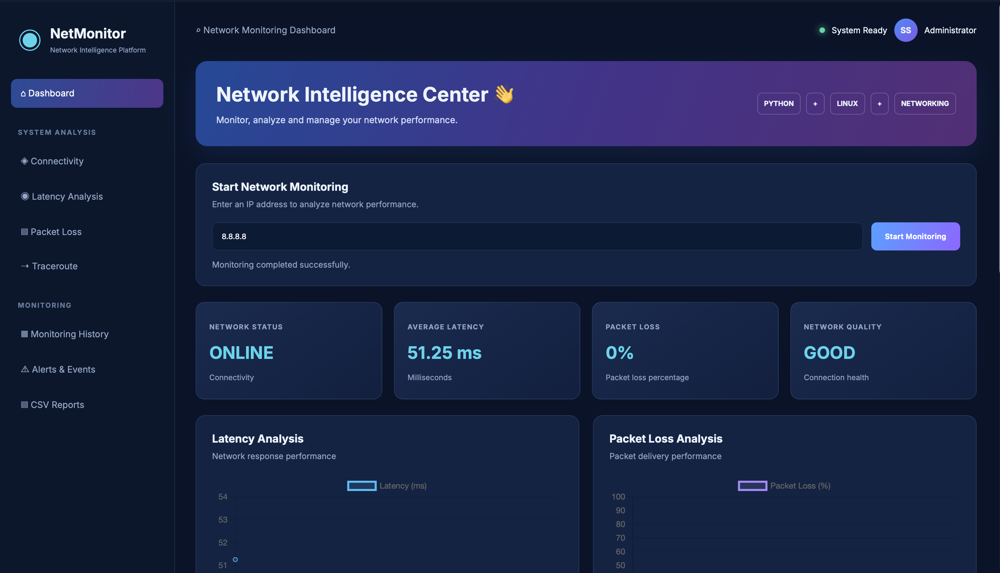

## Dashboard Preview


# Python Network Latency and Packet Loss Monitoring Tool

A Python-based network monitoring application that checks network
connectivity, latency, packet loss and network routes through a
Flask-powered web dashboard.

## Features

- Network connectivity monitoring
- Average latency measurement
- Packet loss detection
- Traceroute analysis
- Network performance alerts
- CSV report generation
- Web-based monitoring dashboard
- Latency and packet loss charts

## Technologies Used

- Python
- Flask
- Linux
- HTML
- CSS
- JavaScript
- Chart.js
- Git and GitHub

## Project Structure

```text
network-monitoring/
├── app.py
├── main.py
├── ping_monitor.py
├── latency.py
├── packet_loss.py
├── traceroute.py
├── alerts.py
├── report.py
├── requirements.txt
├── templates/
├── static/
├── reports/
└── README.md
